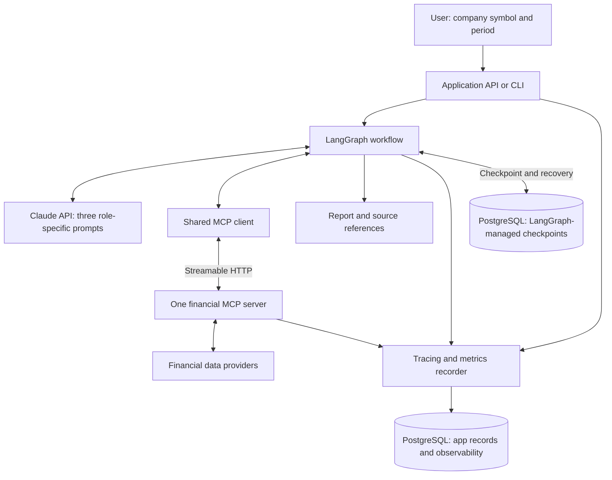
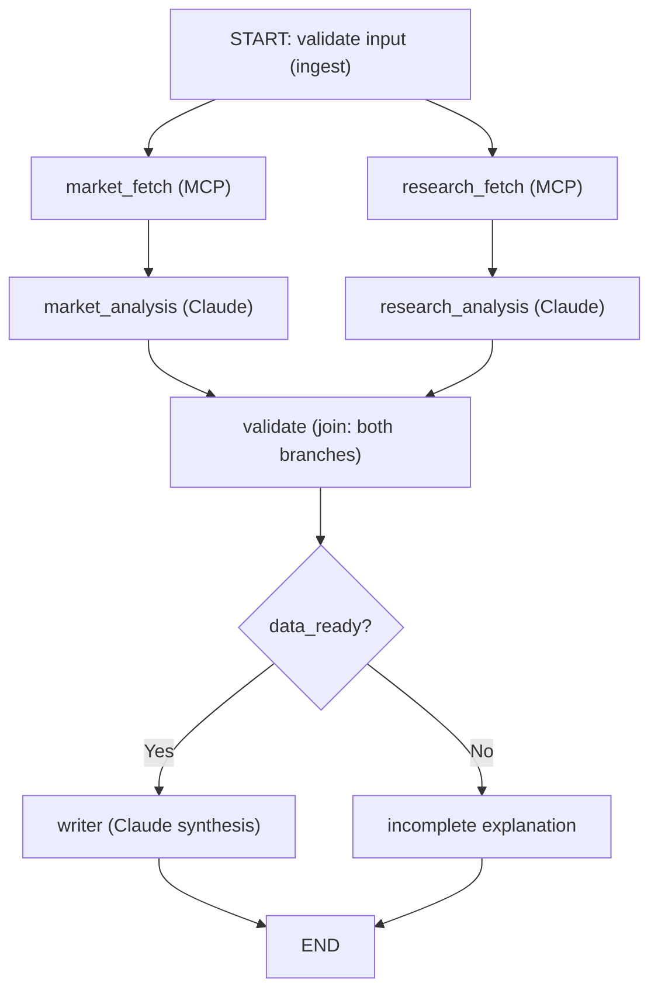

# Finance Analysis Assistant

A beginner-friendly, interview-ready **multi-agent finance analysis workflow**:

- **Three specialist LLM roles** — Market Analyst, Research Analyst, Report Writer — via the **Anthropic Claude** API.
- **LangGraph** for workflow orchestration (parallel branches, a genuine join, a conditional route, and durable checkpoints).
- **One real MCP server** exposing exactly **two** financial-data tools, reached by the app through an **MCP client** over **Streamable HTTP** (FastMCP).
- **PostgreSQL** for both **durable LangGraph checkpoints** (recovery) and **application observability** (tracing, token usage, cost), in separate, clearly-owned storage.

The Market and Research branches run **in parallel**; the writer waits for **both**. "Resume" means recovering a failed run from saved progress — not waiting for a human.

> ### Honest terminology (please read)
> This is a multi-agent **workflow** with three specialized LLM roles. In v1, **code** chooses each analyst's assigned tool explicitly; the **LLM interprets** the evidence. It is **not** an autonomous agent debate — the agents collaborate through shared state, not by chatting with each other. **MCP standardizes tool access; it does not perform reasoning or deployment.**
>
> - Numbers are computed in **deterministic Python**; the model never invents or estimates figures.
> - **Fixture mode** serves clearly-labeled **sample data through the real MCP transport** — it is never presented as live.
> - **Live mode** uses a real provider (stock prices via Stooq) and labels freshness; the system **never silently falls back** from live to fixture. A free live *financials* provider is not wired by default — live financials return a labeled `provider_unavailable`, never fabricated figures.
> - Cost figures are **estimates**, not an invoice. This document does not claim anything has been deployed.

---

## 1. Architecture (HLD)



Both database boxes are **one** PostgreSQL service with separate logical storage:
the SDK-managed checkpoint tables (public schema) and the application `app` schema.

## 2. Workflow (nodes & edges)



Retrieval, validation, routing and failure reporting are ordinary **code** nodes;
only the three analyst/writer steps call an LLM. Splitting retrieval from analysis
means a successful retrieval is **checkpointed before** any later model call can
fail — so a resume re-runs only the failed step.

The join uses the multi-source edge `add_edge(["market_analysis", "research_analysis"], "validate")`, so `validate` runs **once, only after both** analyses complete.

See [docs/ARCHITECTURE.md](docs/ARCHITECTURE.md) for the component map, trace hierarchy, state ownership and the acceptance-criteria mapping.

---

## 3. Prerequisites

- **Docker Desktop** (Compose v2) — the simplest path, or
- **Python 3.11+** and a local **PostgreSQL 16** for running pieces by hand.
- An **Anthropic API key** for runs that actually call the model (the success/writer path). The fixture retrieval, invalid-symbol, and transient-retry behaviors work **without** a key.

> Provide the key only through local environment configuration. Never paste API keys into chat, and never commit a real `.env`.

## 4. Configure

```bash
cp .env.example .env
# edit .env: set ANTHROPIC_API_KEY (and optionally CLAUDE_MODEL / DATA_MODE)
```

Key settings (full list in [.env.example](.env.example)):

| Variable | Meaning |
|---|---|
| `ANTHROPIC_API_KEY` | your key (local only) |
| `CLAUDE_MODEL` | verified model id; default `claude-opus-5-5` (cheaper: `claude-sonnet-5-5`, `claude-haiku-5-5`) |
| `CLAUDE_EFFORT` | `low`\|`medium`\|`high`\|`xhigh`\|`max` — `low` keeps the demo cheap |
| `DATA_MODE` | `fixture` (default) or `live` |
| `MAX_EXTERNAL_ATTEMPTS` | retry budget per transient external op (default 3) |
| `FAIL_AT` | demo: make a node fail once on the initial attempt (e.g. `writer`) |
| `MCP_FAULT_TRANSIENT_SYMBOL` / `MCP_FAULT_TRANSIENT_TIMES` | demo: inject N transient provider timeouts |

> `.env.example` uses Docker hostnames (`postgres`, `mcp-server`). To run pieces **outside** Docker, override `DATABASE_URL` to `...@localhost:5432/...` and `MCP_SERVER_URL` to `http://localhost:8001/mcp`.

## 5. Run the web app (enter a ticker in your browser)

The simplest way to use it. Requires your local PostgreSQL running and `.env`
filled in (`ANTHROPIC_API_KEY` + `DATABASE_URL`). Then:

- **Windows (File Explorer):** double-click **`run.bat`**.
- **Windows (PowerShell):** `.\run.bat` (PowerShell needs the leading `.\`) or `.\run.ps1`.
- **Any OS, with the venv active:** `python launch.py`
- **macOS/Linux:** `python launch.py`

This starts the MCP server and the web app in **live (real-time) mode** and opens
`http://localhost:8000`. Type a stock symbol (e.g. `MS`, `AAPL`, `NVDA`) and
submit; after ~20–40s you land on an **interactive dashboard served by the app
itself** — KPI cards, a live price chart, the analysis and risks — with a
**Download Word report** button. It is a normal `localhost` page (not a
claude.ai artifact link), so it opens in any browser.

App pages:

| Path | What |
|---|---|
| `/` | entry form + recent analyses |
| `/analyses/{id}/dashboard` | interactive dashboard (served by the app) |
| `/analyses/{id}/report.docx` | the Word report (download) |

The JSON endpoints in §14 still work alongside these.

## 6. Run with Docker Compose

```bash
docker compose up --build
```

This starts PostgreSQL (persistent named volume), the **MCP server** (`:8001/mcp`), and the **app API** (`:8000`). Migrations and checkpoint tables are created automatically at startup.

Create and run an analysis (fixture mode, no changes needed):

```bash
curl -s -X POST localhost:8000/analyses \
  -H 'content-type: application/json' \
  -d '{"symbol":"AAPL","start_date":"2023-01-01","end_date":"2023-12-31","reporting_period":"FY2023"}' | jq
```

Then inspect it:

```bash
curl -s localhost:8000/analyses/<run_id> | jq            # status + branch statuses
curl -s localhost:8000/analyses/<run_id>/report | jq     # final report
curl -s localhost:8000/analyses/<run_id>/trace | jq      # trace tree, timing, cost
# Human view:
open http://localhost:8000/analyses/<run_id>/view
```

### HTTP endpoints

| Method | Path | Purpose |
|---|---|---|
| POST | `/analyses` | create + execute a run |
| GET | `/analyses` | list recent runs |
| GET | `/analyses/{run_id}` | run + branch status |
| POST | `/analyses/{run_id}/resume` | resume a failed/interrupted run |
| GET | `/analyses/{run_id}/report` | latest report / incomplete explanation |
| GET | `/analyses/{run_id}/trace` | trace tree, attempt timeline, tokens, cost |
| GET | `/analyses/{run_id}/view` | lightweight HTML run page |

These are **application** endpoints, not MCP endpoints. MCP is exposed separately at `MCP_SERVER_URL`.

## 6. Run with the CLI

The CLI is the simplest demo surface (works inside the `app` container, e.g. `docker compose run --rm app python -m app.cli ...`, or locally):

```bash
python -m app.cli verify-tools                 # confirm the MCP server advertises both tools
python -m app.cli analyze --symbol AAPL --start 2023-01-01 --end 2023-12-31 --period FY2023
python -m app.cli status --run-id <id>
python -m app.cli report --run-id <id>
python -m app.cli trace  --run-id <id>
python -m app.cli resume --run-id <id>
python -m app.cli list
```

## 7. Install & run locally (without Docker)

```bash
python -m venv .venv
. .venv/Scripts/activate            # Windows;  source .venv/bin/activate on macOS/Linux
pip install -r requirements.txt
# Freeze the exact resolved versions (pinned deps):
pip freeze > requirements.lock

# Start Postgres (or `docker compose up -d postgres`), then point .env at localhost.
# Terminal 1 — MCP server:
python -m mcp_server.server
# Terminal 2 — API:
python -m app.main
# or just use the CLI (it starts its own runtime).
```

---

## 8. Interview demo walkthrough

1. **Successful run + overlapping branches.** Run `analyze` for `AAPL`; open the trace (`trace` / `/view`). The two analyst bars **overlap** in the timeline; `writer` starts only after both finish.
2. **Trace & cost.** The trace tree links *app → MCP client → MCP server → provider*; the cost panel shows token categories and an estimated subtotal, with unknown-cost calls counted separately (never shown as zero).
3. **Transient retry.** Set `MCP_FAULT_TRANSIENT_SYMBOL=AAPL`, `MCP_FAULT_TRANSIENT_TIMES=2`, restart the MCP server, and run again. The trace shows **separate attempt spans** for the retried tool call, then success.
4. **Invalid symbol.** `analyze --symbol ZZZZ ...` → both branches fail cleanly (no pointless retries) → the **incomplete** branch is taken, with no fabricated findings.
5. **Writer failure + resume.** Set `FAIL_AT=writer`, run → the run fails *after* retrieval/analysis are checkpointed. Unset `FAIL_AT` (or just resume), then `resume --run-id <id>` → the writer runs using the **saved** analyses; retrieval/analysis are **not** re-called (verify: no new MCP spans for those nodes on the resume attempt).

---

## 9. Testing

```bash
pip install -r requirements.txt
python -m pytest -m "not integration"      # unit + mocked-model tests (no services)
```

Three clearly-distinguished test categories:

- **Fixture tests** — provider/metrics/validation against sample data (`tests/test_providers.py`, `tests/test_metrics.py`).
- **Mocked-model tests** — node logic with fake agents, no real Anthropic calls (`tests/test_workflow_nodes.py`).
- **Real Anthropic tests** — the full success/writer path; run manually with a real key via the CLI/API.

See the **Verification status** section at the end for observed results.

---

## 10. Observability & cost (how to read it)

- A **trace** spans processes: *root → node → mcp_client → mcp_server → provider_http*, and *node → llm*. Correlation uses explicit headers (`x-trace-id`, `x-parent-span-id`, `x-run-id`, `x-execution-attempt-id`) plus a W3C `traceparent`. Tracing fields never appear in model-visible tool arguments.
- **Timing** distinguishes `total_elapsed` (first start → last finish, includes downtime) from `active_run` (sum of attempt durations). Parallel branch durations are **not** added; nested span durations are **not** summed.
- **Cost** uses the **actual** Anthropic usage metadata with disjoint token categories (input, output, cache-read, cache-write 5m/1h). Each real call is aggregated **once**. Rates come from a **versioned pricing row** (`app.pricing`) with source + checked date — nothing is hard-coded in Python. Unknown rate or missing usage → `NULL`/unknown, never zero.
- Payloads are **sanitized** (secrets redacted), **size-capped**, and **hashed**. With `LOG_PAYLOADS=false`, only hashes are stored. No API keys, headers, or connection strings are ever logged — the same discipline applies to checkpoints.
- A process kill leaves `running` spans; on resume they are reconciled to `unknown` (not an invented completion, and distinct from a confirmed failure).

---

## 11. Verified SDK versions (checked 2026-10-22)

| Package | Pinned | Notes |
|---|---|---|
| `anthropic` | 2.1.0 | `AsyncAnthropic`, `messages.create`, disjoint usage categories |
| `fastmcp` | 4.1.3 | `FastMCP` server over Streamable HTTP; `Client` + `StreamableHttpTransport(headers=...)`; `get_http_request()` server-side |
| `langgraph` | 1.2.16 | `StateGraph`, list-source join edge, async nodes |
| `langgraph-checkpoint-postgres` | 3.2.0 | `AsyncPostgresSaver` (requires `psycopg>=3.2`) |

Official references consulted: LangGraph [graph API](https://docs.langchain.com/oss/python/langgraph/graph-api) & [persistence](https://docs.langchain.com/oss/python/langgraph/persistence); MCP [architecture](https://modelcontextprotocol.io/docs/learn/architecture); FastMCP [docs](https://gofastmcp.com); Anthropic [pricing](https://platform.claude.com/docs/en/about-claude/pricing).

## 12. Limitations (v1, by design)

- No autonomous supervisor, agent debates, Redis, vector DB, RAG, Kubernetes, automatic trading, or human-approval gates.
- Live **financials** provider not wired (returns labeled `provider_unavailable`). Live **stock** prices via Stooq are raw close (not split/dividend adjusted), labeled accordingly.
- `app.spans.run_id` is nullable so a cross-process server span is still recorded if correlation headers are absent; it is populated in normal operation.
- The demo runs analyses synchronously (CLI/API). A durable job queue is out of scope; resume is the recovery mechanism.
- Cost estimates are **not** an invoice; cache-write TTL rates are derived from Anthropic's published multipliers and recorded in `app.pricing.modifiers`.

---

## 13. Verification status (observed 2026-10-22 · Windows 11 · Python 3.11.9)

| What | Command | Result |
|---|---|---|
| Unit + mocked-model tests | `pytest -m "not integration"` | **40 passed** |
| LangGraph topology (standalone, in-memory saver) | internal check | join runs once, branches **overlap**, resume does **not** re-run retrieval — **PASS** |
| FastMCP transport (standalone) | internal check | HTTP transport, client→server header propagation (`get_http_request`), structured results, `is_error`, health route — **PASS** |
| Full stack e2e — real **PostgreSQL 18** + real MCP Streamable HTTP, mock agents | `tests/test_integration.py` (see its header) | SUCCESS completed; branches overlap; **cross-process trace correlation** app→MCP-client→MCP-server; invalid symbol → **incomplete** (no fabrication); **writer failure → resume → completed** with retrieval **not re-called**; attempts `[initial=failed, resume=completed]` — **PASS** |

Distinguishing the three test kinds (acceptance #13): *fixture* tests use sample
data; *mocked-model* tests use fake agents (no Anthropic call); the *real
Anthropic* path (success/writer LLM calls) is exercised manually via the CLI/API
with your key — it was not run here (no key in this environment).

**Not run here:** the Docker Compose path — the local Docker/WSL engine was
unavailable in this environment, so the stack was verified against a local
PostgreSQL 18 instead. The Compose config is standard and provided as-is.

**Fixes made during verification** (Windows/SDK integration, now in the code):
1. Set `WindowsSelectorEventLoopPolicy` at each entry point — psycopg async cannot
   use Windows' default ProactorEventLoop (`app/eventloop.py`).
2. Typed workflow node `config` as `RunnableConfig` — LangGraph 1.x only injects
   the config argument when it is annotated as such.
3. Coerced trace-header values to `str` and `uuid.UUID`→`str` in the JSON
   serializer — psycopg returns UUID columns as `uuid.UUID`, which HTTP headers
   reject.

---

*This document describes the intended application and its current state. It does not claim that a live deployment exists.*
