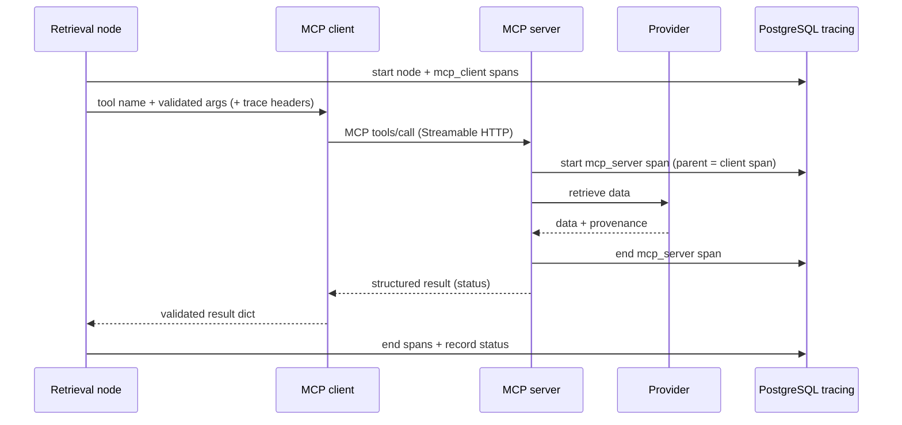

# Architecture & design notes

Companion to the [README](../README.md). Covers the component map, trace
hierarchy, state ownership, key design decisions, and how each acceptance
criterion is met and verified.

## Components (LLD)

| Component | Responsibility | Where |
|---|---|---|
| `AnalysisService` | create / execute / resume / status; per-thread lock + DB heartbeat guard | `app/service.py` |
| `WorkflowDeps` + `build_graph` | nodes, parallel branches, join, route, Postgres checkpointer | `app/workflow/` |
| `Nodes` | retrieval, analysis, validation, writer, incomplete (partial state updates) | `app/workflow/nodes.py` |
| `MarketAnalyst` / `ResearchAnalyst` / `ReportWriter` | versioned prompt + evidence → structured response | `app/agents/` |
| `ClaudeAgent` (base) | one Claude call, retry ownership, usage recording | `app/agents/base.py` |
| `FinanceMCPClient` | SDK connection lifecycle, tool discovery, concurrent calls, trace headers | `app/mcp/client.py` |
| `FastMCP` server + 2 tools | contract validation, provider adapters, server-side spans | `mcp_server/server.py` |
| `ProviderAdapter` | fixture + live providers, same output contract | `mcp_server/providers.py` |
| `TraceRecorder` | spans/events, redaction, bounded payloads, trace correlation | `app/observability/tracing.py` |
| `UsageRecorder` | token normalization + versioned cost estimate | `app/observability/usage.py` |
| `Repositories` + migrations | `app` schema data access | `app/db/` |

Composition + injected dependencies throughout; no inheritance trees, no
microservice-per-agent. Transport is a real MCP SDK (FastMCP), not an imitation.

## State ownership

Each key is written by exactly one node (disjoint ownership), so there are no
concurrent-write conflicts and no reducers are needed. Branch sources/errors are
branch-specific and merged at validation. See `app/workflow/state.py`.

| Field group | Writer node |
|---|---|
| identity/input | `ingest` (seeded at run creation) |
| `market_data/_fetch_status/_fetch_error/_sources` | `market_fetch` |
| `market_analysis/_status/_error` | `market_analysis` |
| `financial_data/_fetch_status/_fetch_error/_sources` | `research_fetch` |
| `research_analysis/_status/_error` | `research_analysis` |
| `data_ready/validation_issues` | `validate` |
| `final_report/result_status` | `writer` or `incomplete` |

Credentials and DB handles are **never** in state or checkpoints — they are
injected via the `Nodes` closure; only small serializable values (thread/run/
trace/attempt ids, attempt kind, fault target) travel in `config.configurable`.

## One tool-call sequence



## Trace hierarchy

```
root (node) ─┬─ mcp_client (attempt N) ── mcp_server ── provider_http
             └─ llm (attempt N)
validate / route decision / report persistence / recovery are recorded too.
```

Correlation uses explicit headers (`x-trace-id`, `x-parent-span-id`, `x-run-id`,
`x-execution-attempt-id`) plus W3C `traceparent`. We use explicit UUID headers
because our span ids are UUIDs (per the schema) while W3C span-ids are 16-hex;
this is the documented "explicit correlation mechanism" fallback and it is
tested (server reads the header back; see verification below).

## Retry ownership

One retry layer (`app/retry.py`), used by the MCP client and the agent base.
The Anthropic SDK's own retries are disabled (`max_retries=0`) and no LangGraph
node retry policy is used, so attempts never multiply. Transient only
(`rate_limited`, `provider_timeout`, `provider_unavailable`, 5xx, timeouts,
connection errors; `RateLimitError` honors `Retry-After`). Never retried: invalid
arguments, invalid credentials, refusals, `no_data`. A provider error that never
clears is a **branch failure** (reaches validation); an unexpected tool crash or
unresolved transport failure stops the run **visibly**.

## PostgreSQL: recovery vs observability

* **Checkpoints** — SDK-managed tables created by `AsyncPostgresSaver.setup()`
  (public schema). Never altered by us. Separate connection pool
  (`prepare_threshold=0`), so observability traffic cannot starve checkpoint
  writes.
* **Observability** — the `app` schema (`app/db/migrations/0001_init.sql`), its
  own pool, applied by a small advisory-locked migration runner.

## Time / cost rules

* `total_elapsed` = first start → last finish (includes downtime);
  `active_run` = Σ attempt durations. Parallel branch durations are not added;
  nested span durations are not summed (`app/views.py`).
* Disjoint Anthropic token categories; each actual call aggregated once; rates
  from the versioned `app.pricing` row; unknown → `NULL`, never zero
  (`app/observability/usage.py`).

## Acceptance criteria → implementation & verification

| # | Criterion | Where | Verified |
|---|---|---|---|
| 1 | Fixture uses real MCP transport, labels sample data, completes a report | `providers.py`, `server.py` | e2e: TOOLS via real transport; report produced |
| 2 | Branches overlap; writer waits for both | `graph.py` join edge | langgraph check: `ANALYSIS_OVERLAP: True`, join runs once; e2e overlap |
| 3 | Each analyst writes its own keys, no conflicts | `state.py` (disjoint keys) | runs complete with no reducer conflicts |
| 4 | Insufficient evidence → incomplete, no fabrication | `nodes.validate/incomplete` | unit `test_workflow_nodes`; e2e invalid-symbol |
| 5 | Transient failure retries within limit, separate attempt spans | `retry.py`, `mcp/client.py` | unit `test_retry`, `test_providers`; attempt spans per call |
| 6 | Invalid symbol fails clearly, no pointless retries | `contracts.py`, non-transient classify | unit; e2e invalid-symbol → incomplete |
| 7 | Writer failure + restart resumes same thread; checkpointed steps not rerun | `service.resume_run`, checkpointer | langgraph check: fetches not re-run; e2e resume |
| 8 | One branch failing preserves the other's checkpointed work | checkpointer + branch-specific keys | langgraph/e2e resume |
| 9 | Trace links app/MCP/provider; no creds in payloads/checkpoints | `tracing.py` | unit redaction; e2e cross-process correlation |
| 10 | LLM calls record model+usage; unknown ≠ zero; no double count | `usage.py`, `repositories.get_cost_summary` | unit `test_usage_cost` |
| 11 | PG restart preserves volume; concurrent resume rejected/serialized | compose volume; `service` lock+guard | guard unit-reasoned; volume in compose |
| 12 | Crash leaves interrupted/unknown telemetry, not invented success | `reconcile_running_spans`, visible-stop paths | `service` + `repositories` |
| 13 | Document results, commands, limitations; distinguish test types | README + this doc | README §9, §Verification |

## Design decisions / deviations

- `app.spans.run_id` is nullable so a cross-process server span is still recorded
  if correlation headers are missing (normally populated).
- `runs.final_report_id` has no FK (avoids a runs↔reports cycle); it is a plain
  pointer set after the report row exists.
- Live financials provider intentionally returns `provider_unavailable` (no free
  licensed source wired) — never fabricated.
